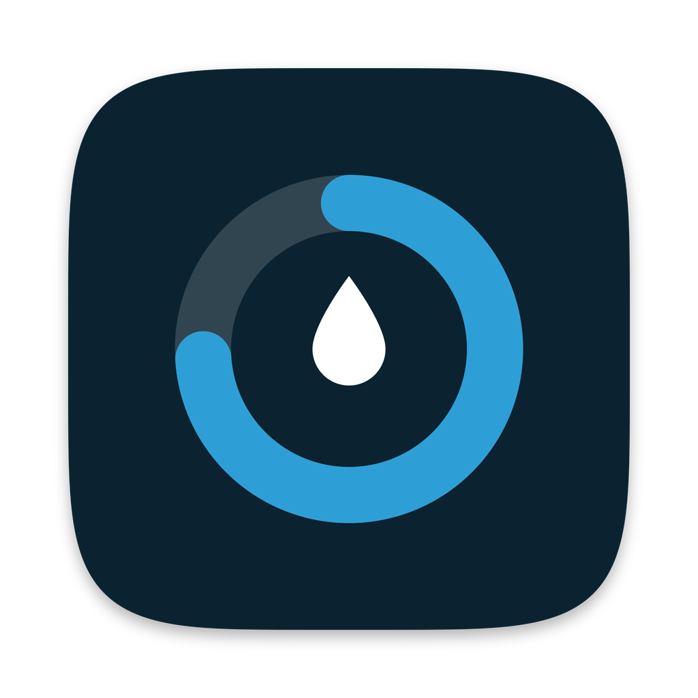
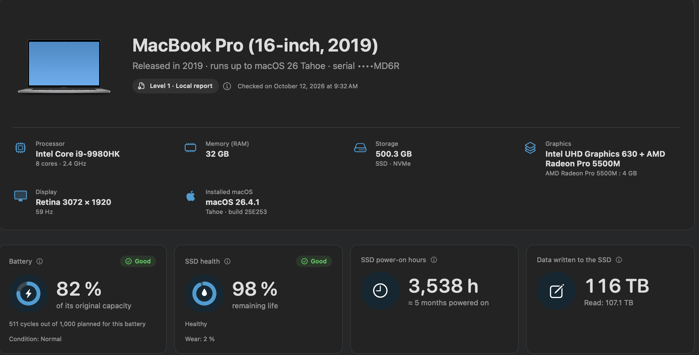
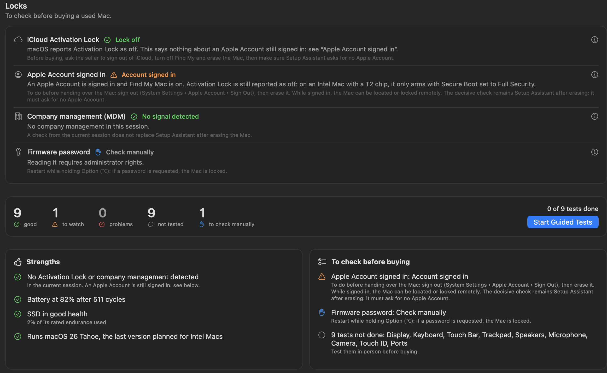
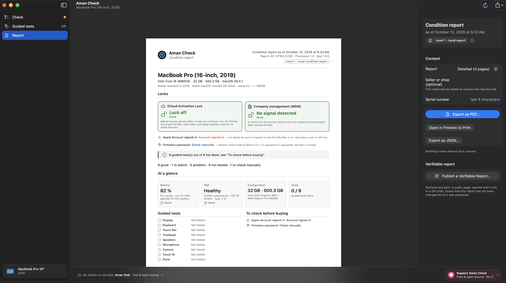
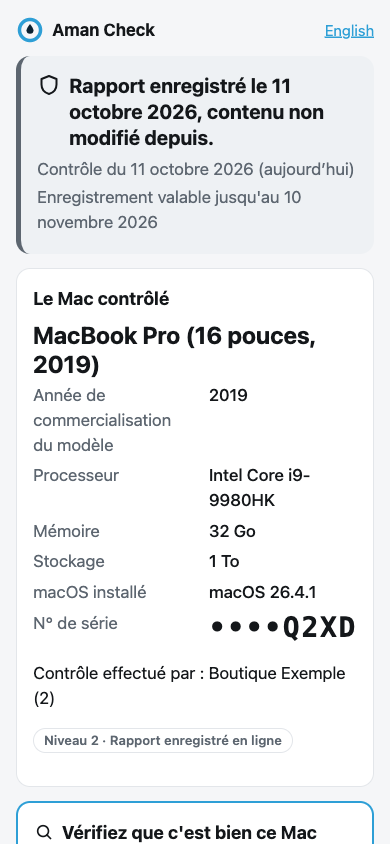
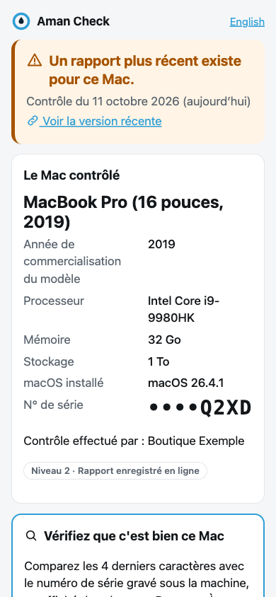
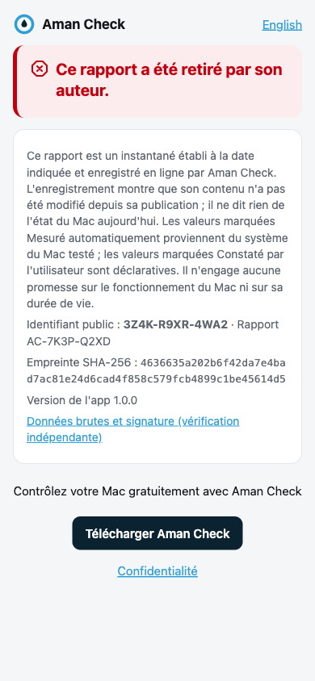

<p align="center">
  
</p>

<h1 align="center">Aman Check</h1>

<p align="center"><b>A dated, honest condition report for a used Mac, readable by anyone.</b><br>
Locks, battery, SSD, sensors, configuration, then guided tests of the screen, keyboard, trackpad, speakers, camera, lid sensor and ports. Native macOS app · Nothing leaves your Mac.</p>

<p align="center">
  <a href="https://github.com/MidZai/aman_check/releases/latest">
    
  </a>
  &nbsp;
  <a href="https://ko-fi.com/midzai">
    
  </a>
</p>

<p align="center"><b>Help get Aman Check signed by Apple.</b> The Apple Developer Program costs $99 a year. With it, the app can be signed and notarized, and macOS stops blocking it the first time. Donations on <a href="https://ko-fi.com/midzai">Ko-fi</a> go toward it first.</p>

<p align="center">
  <sub>Free and open source · macOS 13 or later · Apple Silicon and Intel · <a href="https://github.com/MidZai/aman_check/releases/latest">Latest version</a> · <a href="https://midzai.github.io/aman_check/">Website</a> · Sister project: <a href="https://github.com/MidZai/aman_disk">Aman Disk</a></sub>
</p>

<p align="center">
  
</p>

## Screenshots

| Locks, counters and what to check before buying | Report, ready to export as PDF |
|---|---|
|  |  |

## What it is for

Buying or selling a used Mac between private individuals usually comes down to trust. Aman Check runs on the Mac being sold and produces a **condition report**: a dated snapshot of what can be measured, plus the result of tests the person carries out themselves. The report is exported as a PDF and a JSON file.

It is written for non-technical people: plain words, one status per line, and a clear mention of where each value comes from (*Measured automatically*, *Observed by the user* or *Calculated*).

## What it checks

**Automatic analysis** (a few seconds, no password asked)

- **Locks and blockers**: iCloud Activation Lock, Apple Account signed in (only the number of accounts and the Find My state, never the e-mail), company management (MDM), firmware password, System Integrity Protection, FileVault, virtual machine detection, configuration profiles, security chip. A blocker is always shown first, in red.
- **Battery**: charge cycles, current full-charge capacity compared with the original capacity, condition reported by macOS, power source, temperature.
- **Storage**: S.M.A.R.T. health of the internal SSD, power-on hours, data written, wear, spare capacity, data errors, temperature, model and interface. Uses the engine of [Aman Disk](https://github.com/MidZai/aman_disk).
- **Configuration**: model and release year, processor and cores, graphics, memory, storage, display, installed macOS and latest supported macOS, Wi‑Fi and Bluetooth.
- **Sensors**: number of fans, current fan speed and processor temperature, read from the system management controller (SMC). Fanless Macs say "No fan on this model". A single temperature is never more than "needs attention".

**Guided tests** (the person does them, the app records the result)

- **Display**: full-screen solid colours, Dock and menu bar included, to spot dead pixels and stains.
- **Keyboard**: every key turns green when pressed, including modifiers and arrows; ANSI, ISO or JIS layout detected automatically.
- **Touch Bar**, **trackpad** (click, secondary click, scroll, pinch, rotate, force click, 8×5 grid), **speakers** (left and right), **microphone** (level meter and a 3‑second playback), **camera** (live preview, nothing recorded), **Touch ID**.
- **Ports**: a USB stick validates each port without a click; charging, video output, headphone jack and SD card reader are checked too.
- **Lid sensor** (close the lid, wait, open it: sleep and wake are detected), **ambient light sensor** (shine a phone flashlight on it, or cover it: the app reads the sensor itself when the Mac allows it) and **keyboard backlight**. A faulty lid sensor was the case that started this, reported on Reddit.

An external keyboard or mouse is detected before the keyboard and trackpad tests, so the built‑in hardware is what gets tested.

On a desktop Mac (iMac, Mac mini, Mac Studio, Mac Pro), the keyboard and trackpad are accessories. Their tests are **optional**: do them if the accessories come with the Mac. A test done goes into the report with the accessory's name; a test not done is not counted.

**Report**

- PDF (A4) and JSON export, plus a diagnostic log export.
- **Share** button: send the PDF to the buyer straight from the Mac (AirDrop, Messages, Mail…).
- **Offline QR code** on the first page: a short plain-text summary (model, last 4 characters of the serial number, battery, SSD hours, locks, counters), readable by any QR code reader. No link, no server. It says what it is: a summary, not a proof that the report is authentic. Can be turned off in Settings.
- Counters only: *X good · Y to watch · Z problems · N not tested*. No global score, no grade.
- The serial number is never shown or exported in full (last 4 characters only).

## What the report does not say

Aman Check is deliberately careful with words, because a flattering report can cost a buyer real money.

- A missing or inconsistent value is **never green**. It becomes “Not available” or “Manual check”.
- A test that is skipped or interrupted, or a permission that is refused (camera, microphone), is **“Not tested”**, never “Failed”.
- The report never says “certified”, “warranty”, “tamper-proof”, “100% working” or “Grade A”. It is a snapshot taken on the date shown, and says so at the bottom of every page.
- Level 1 (what the app does today) is a **local condition report**: a self-diagnosis, not a certification.

## Privacy

- **No network connection** at level 1. Aman Check never connects to the Internet by itself: no telemetry, no update check. The links in the app (GitHub, Ko-fi) open in your browser when you click them.
- **Nothing is changed** on the Mac being checked. The app only reads; the only files it writes are the reports you choose to save, a temporary copy of the PDF when you use Share, and its own preferences (language, display options). No administrator password is ever asked.
- **Camera and microphone** are only used during the tests you start, and nothing is kept.
- The optional online publication (see below) is not available in this version. When it is, it will only happen after an explicit click, and the screen before it lists exactly what will be sent.

## Installation

1. Download the DMG from the [latest release](https://github.com/MidZai/aman_check/releases/latest).
2. Open it and drag **Aman Check** into the **Applications** folder.
3. Open Aman Check. The first time, macOS blocks it: follow the steps below. You only need to do this once.

### macOS says Aman Check can't be opened

Aman Check is free and open source, but it isn't signed with a paid Apple Developer ID, so macOS can't verify who made it and blocks it the first time. The source code is all here, and you can [build the app yourself](#build-from-source).

**macOS 15 Sequoia or later**

1. Open Aman Check, then click **Done** in the warning.
2. Go to **System Settings › Privacy & Security** and scroll down to **Security**.
3. Next to “Aman Check was blocked to protect your Mac”, click **Open Anyway**, then confirm with your password or Touch ID.

If the **Open Anyway** button isn't there, open Aman Check once more, then go back to System Settings.

**macOS 13 Ventura and macOS 14 Sonoma**: in the **Applications** folder, Control-click **Aman Check**, choose **Open**, then click **Open**.

**Or, in Terminal** (any version), remove the download flag that macOS checks:

```bash
xattr -dr com.apple.quarantine "/Applications/Aman Check.app"
```

### Build from source

Swift Package Manager only, no Xcode project. The Command Line Tools are enough.

```bash
./build_app.sh                 # Aman Check.app for this machine's architecture
UNIVERSAL=1 ./build_app.sh     # universal binary (Apple Silicon + Intel), ad hoc signature, Hardened Runtime
./scripts/make-dmg.sh          # dist/Aman-Check-<version>.dmg
./scripts/notarize.sh          # Developer ID signature and notarization, once an Apple Developer ID exists (docs/RELEASE.md)
./scripts/test.sh              # unit tests (Swift Testing), also works without Xcode
```

Useful launch arguments during development:

```bash
open -n "Aman Check.app" --args --simulate-model Macmini9,1   # profile of another Mac
open -n "Aman Check.app" --args --snapshot ~/Desktop/shots     # render every screen to PNG and the report to PDF
open -n "Aman Check.app" --args --language ja                  # force a language
```

## Compatibility

- **macOS 13 Ventura** or later.
- **Apple Silicon** and **Intel** Macs. The model catalog covers Macs released up to early 2025 that can run macOS 13, MacBook Pro, MacBook and iMac 2017 included.
- Tests adapt to the machine: Touch Bar, Touch ID, headphone jack, SD card reader, HDMI, MagSafe and battery only appear when the model has them.
- Developed and verified on an Intel MacBook Pro with a T2 chip. Some readings specific to Apple Silicon and to desktop Macs (sensor keys) are listed as not yet verified in [docs/VERIFICATION.md](docs/VERIFICATION.md). Reports from other machines are welcome.

## Verifiable online report (level 2)

The report will optionally be **publishable online**: the exact bytes of the report are stored on a server, signed with Ed25519, and the PDF gets a QR code and a public link. A buyer who scans the code sees the same report and can check it has not been changed since. The seller can withdraw it from the Mac that published it.

- The app sends nothing until you click “Publish” and confirm the list of what will be sent.
- Only the last 4 characters of the serial number leave the Mac.
- The server lives in [`server/`](server/README.md): Cloudflare Workers, Hono, D1, no JavaScript on the public page. Licence keys, prices and payment are configuration, never code in the app.

The service is **not deployed yet** (the domain has not been chosen), so the publishing section is hidden in the app; it appears on its own once the real address is set. For development, `--publish-server http://127.0.0.1:8787` points the app at a local server; see [server/README.md](server/README.md) and [docs/LEVEL2-SPECIFICATION.md](docs/LEVEL2-SPECIFICATION.md).

| Public page (valid) | Replaced | Withdrawn |
|---|---|---|
|  |  |  |

## Languages

The interface is available in 18 languages: English, Français, 简体中文, 繁體中文, 한국어, 日本語, Deutsch, Español, Português do Brasil, Русский, العربية (right-to-left layout), Italiano, Nederlands, Polski, Türkçe, हिन्दी, Tiếng Việt, Українська.

English and French live in the code. The 16 other languages come from `scripts/translations/<lang>.json`, turned into Swift tables by `scripts/gen_translations.py`. `scripts/extract_strings.py --missing` lists what is still untranslated. Corrections are welcome as pull requests.

## Documentation

- [docs/SPECIFICATION.md](docs/SPECIFICATION.md): product and technical specification (French), including the vocabulary rules.
- [docs/LEVEL2-SPECIFICATION.md](docs/LEVEL2-SPECIFICATION.md): specification of the verifiable online report (French).
- [docs/VERIFICATION.md](docs/VERIFICATION.md): manual checklist and what has not been verified yet (French).
- [docs/RELEASE.md](docs/RELEASE.md): how a release is built, with or without Apple notarization (French).
- [docs/LEGACY-MACOS-AUDIT.md](docs/LEGACY-MACOS-AUDIT.md): what supporting macOS 12 Monterey would take (French).
- [CHANGELOG.md](CHANGELOG.md).

## Why “Aman”?

The name has three meanings, and all of them fit:

- In **Kabyle**, *aman* means water, hence the drop at the center of the icon. The ring around it is also ⴰ, the letter A of the Tifinagh alphabet.
- In **Tolkien**'s world, Aman is the Blessed Realm, the land in the far West where the Valar live.
- In **Arabic**, *amān* (أمان) means safety and security, and also peace of mind: the calm of knowing you are protected.

## Support the project

Aman Check is free and open source. If it helped you buy or sell a Mac with a clear head, you can support its development on Ko-fi.

The first goal is the **Apple Developer Program** ($99 a year): with it, Aman Check can be signed and notarized by Apple, and macOS stops blocking it the first time it opens.

<a href="https://ko-fi.com/midzai"></a>

## License

[MIT](LICENSE) © 2026 MidZai
